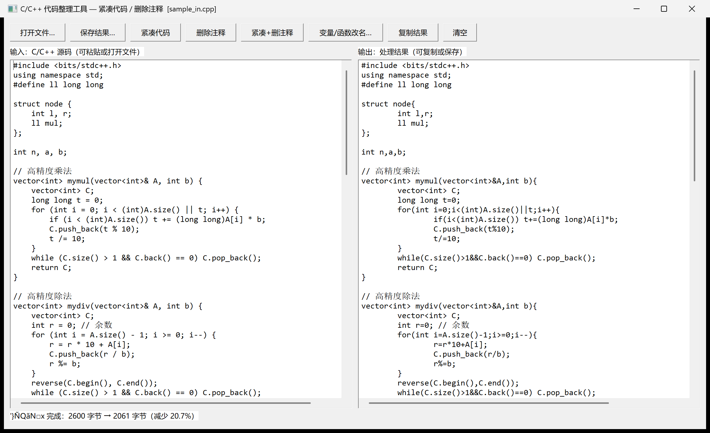
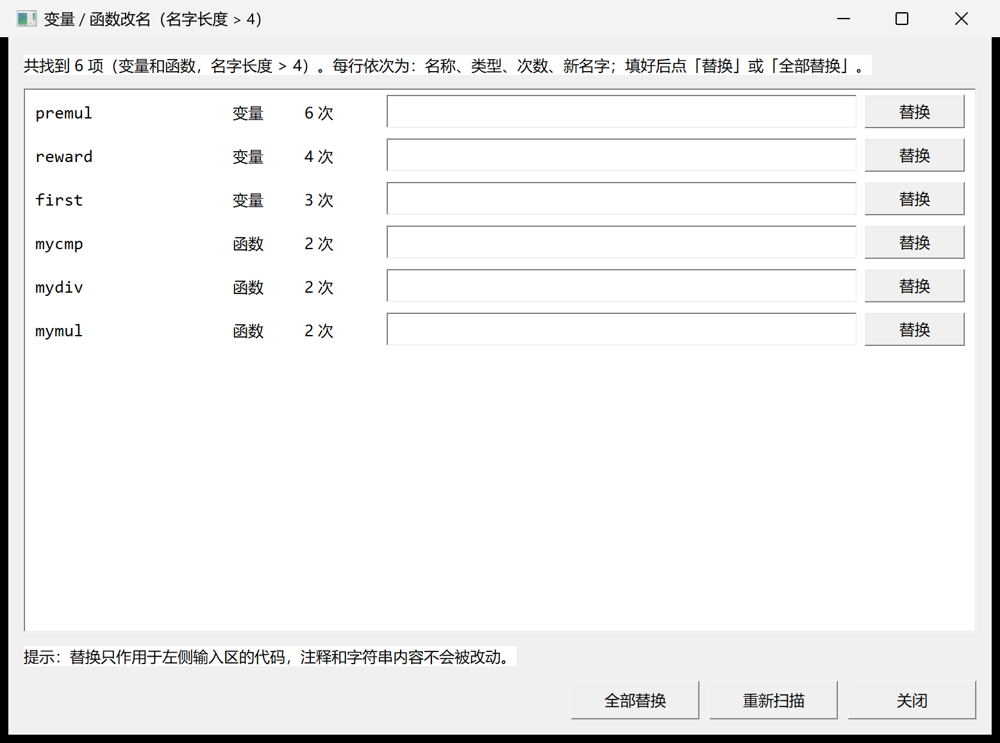

# CodeTool — C/C++ 代码整理工具

一个面向 C/C++ 源码的轻量整理工具，提供图形界面和命令行两种用法。



## 功能

1. **紧凑代码**：删除多余空格，并整理换行与花括号；在不改变语义的前提下压缩代码。
2. **删除注释**：删除 `//` 与 `/* */` 注释；字符串、字符常量、原始字符串里的内容不动。
3. **紧凑 + 删注释**：先删注释再紧凑。
4. **变量 / 函数改名**：列出输入代码中名字长度超过 4 的变量和函数及出现次数，每一项都可以填写新名字，单独替换或全部替换。



## 编译

需要 g++（MinGW-w64，支持 C++17）。

```bat
build.bat
```

或手动编译：

```bash
g++ -std=c++17 -O2 -mwindows -static -o bin/CodeTool.exe CodeTool.cpp -lcomdlg32 -lgdi32
```

`-static` 让生成的 exe 不依赖 MinGW 运行库，可直接拷到别的机器运行。

## 使用

### 图形界面

双击 `bin/CodeTool.exe`：

- 左侧粘贴代码，或点「打开文件…」载入 `.c/.h/.cpp/.cc/.cxx/.hpp/.hh/.hxx`
- 点「紧凑代码」「删除注释」「紧凑+删注释」，结果显示在右侧
- 「复制结果」「保存结果…」导出
- 「变量/函数改名…」打开改名窗口，逐项填写新名字并替换
- 也支持把文件路径作为命令行参数传入，或用「打开方式」关联

### 命令行（自测 / 批量处理用）

```bash
g++ -std=c++17 -O2 -DCODETOOL_CLI -o codetool_cli.exe CodeTool.cpp

codetool_cli compact  input.cpp  [-o output.cpp]
codetool_cli strip    input.cpp  [-o output.cpp]
codetool_cli both     input.cpp  [-o output.cpp]
codetool_cli vars     input.cpp  [最小名字长度=4]
codetool_cli rename   input.cpp  旧名 新名 [-o output.cpp]
```

## 紧凑规则

删除：

- 运算符两侧空格：`+ - * / = < > && || -> ::` 等
- 变量、参数、下标、成员访问两侧的非必要空格：`foo ( a , b )` → `foo(a,b)`
- 逗号后、`for` 内分号后的空格
- 控制关键字与左括号之间的空格：`if (x)` → `if(x)`
- 大括号前的空格：`main() {` → `main(){`

保留：

- 关键字与标识符之间的空格：`int a;`
- `return` / `case` / `throw` 等关键字后的空格
- 语句块内层空隙：`{ return x; }`
- 连续 2 个及以上空行压缩为 1 个空行（字符串 / 原始字符串内部不动）
- 任何去掉后会造成词法合并的空格，例如 `a - -b` 不会变成 `a--b`，`> >` 不会变成 `>>`

排版：

- 函数形参列表、调用实参列表收拢到一行
- 函数定义的左花括号跟随函数名（`f(...){`），函数右花括号另起一行
- 赋值、流、算术、比较、逻辑等表达式的续行并到同一行
- `if` / `for` / `while` 的单行单语句块在确认语义不变时去掉外层花括号
- 无花括号的单语句体前补一个空格：`if(x) return 1;`
- 不能安全处理的情况（宏、多行注释、声明、标签、嵌套控制流等）保持原样

缩进：行首每 4 个空格转为 1 个 Tab（原本用 Tab 的保持不变）。

## 删注释规则

- 支持 `//`（含反斜杠续行）与 `/* */`；块注释内部的换行保留，不会把后面的代码挤到一行
- 字符串、字符常量、原始字符串内的 `//`、`/*` 不动，`1'000'000` 的数字分隔符不会被当成字符常量
- 注释两侧如果拼在一起会变成另一个 token，会补一个空格：`return/**/0;` → `return 0;`
- 被删注释的整行若只剩空白，会清成空行

## 安全设计

- 紧凑前后会比对 token 序列，完全一致才写出，否则报错放弃
- 输入上限 16 MB，仅用于防止无限输入；超出会明确提示并放弃处理
- 支持 UTF-8 / 带 BOM / CRLF 文件，界面内正常显示换行，保存时还原原文件的换行风格
- 处理在内存中完成，默认输出到新文件，不覆盖原文件

## 已知限制

- 只针对 C/C++
- 变量 / 函数识别是启发式的，宏套宏、极端模板写法可能漏报或标签判错
- 改名是文本级替换，没有作用域分析，不同作用域的同名标识符会一起改
- 紧凑排版规则是固定风格，不可配置；个别极端写法在自检不通过时会报错放弃，而不是输出可能错误的代码

## 目录结构

```
CodeTool.cpp          单文件源码（GUI + CLI 自测入口）
build.bat             Windows 一键编译
bin/CodeTool.exe      已编译好的 64 位 Windows 程序
docs/                 截图
```
